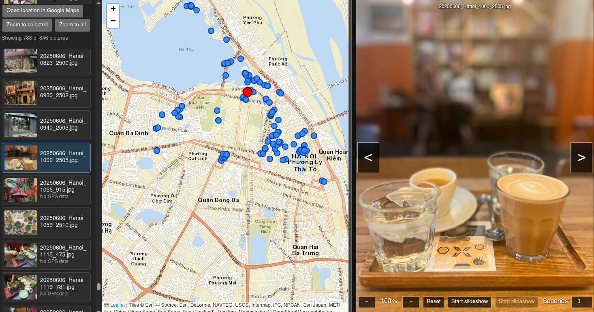

#+title: visho

VISHO is a Python application for browsing JPEG photographs in a chosen folder and visualizing
their GPS locations on an interactive map.

* Overview

=visho= builds an interactive web map of JPEG photographs. It reads GPS
coordinates from EXIF metadata and generates a local Leaflet application with:

- An interactive map with GPS markers
- A scrollable thumbnail list
- An image viewer
- Image zooming and panning
- Previous and next picture navigation
- Slideshow controls
- Google Maps links for geotagged pictures
- CSV export
- Cached thumbnails and generated web files

* Requirements

- Python 3.10 or newer
- Pillow
- A web browser
- Internet access for Leaflet and map tiles

The generated map uses Leaflet and Esri ArcGIS World Street Map tiles from their public CDN and tile service.

* Installation

Clone or copy the project and run it:
#+begin_src shell
cd visho_app
chmod +x run_visho.py
python run_visho.py
#+end_src

* Usage

** Interactive directory selection

Run =visho= without a directory argument:

#+begin_src shell
visho
#+end_src

The application starts in the directory configured by =visho/config.py= and displays an interactive prompt.

Available prompt commands include:

| Command        | Description                  |
|----------------+------------------------------|
| =y=, =yes=, =select= | Select the current directory |
| =cd PATH=        | Change to another directory  |
| =ls [PATH]=      | List directory contents      |
| =pwd=            | Print the current directory  |
| =up=             | Move to the parent directory |
| =h=, =help=, =?=     | Show help                    |
| =q=, =quit=, =exit=  | Exit the application         |

Paths containing spaces should be quoted.

** Use a directory directly

Provide the photo directory as a positional argument:

#+begin_src shell
visho ~/Pictures/trip
#+end_src

The path may be absolute or relative to the current working directory.

** Do not open a browser

Use =--no-browser= to generate the files without opening the result:

#+begin_src shell
visho ~/Pictures/trip --no-browser
#+end_src

** Alternative entry points

The application can also be started with Python:

#+begin_src shell
python -m visho
#+end_src

From the project directory, the standalone runner can be used if present:

#+begin_src shell
python run_visho.py
#+end_src

* Input files

=visho= searches only the selected directory itself; subdirectories are not searched recursively.

Supported extensions are:

- =.jpg=
- =.jpeg=

File extensions are matched case-insensitively.

Each candidate image is opened and verified with Pillow. Invalid or unreadable JPEG files are skipped.

* EXIF GPS data

GPS coordinates are read from the image EXIF GPS information and converted from degrees, minutes, and seconds to decimal degrees.

Pictures with valid GPS data appear on the map as markers. Pictures without GPS data remain available in the list and viewer but do not receive a map
marker.

The viewer indicates pictures without GPS data, and map-related controls report when GPS data is unavailable.

* Generated output

Generated files are stored in the user's cache directory rather than inside the photo directory.

The output directory is:

#+begin_example
~/.cache/visho/<directory-id>/locations/
#+end_example

The =<directory-id>= value is a stable hash derived from the resolved photo
directory path.

The generated directory contains:

| File          | Description                              |
|---------------+------------------------------------------|
| =index.html=    | Main map and image viewer                |
| =style.css=     | Generated application's styles           |
| =app.js=        | Generated application's JavaScript       |
| =locations.js=  | Photo data used by the web application   |
| =locations.csv= | CSV export of all discovered photographs |
| =thumbnails/=   | Cached JPEG thumbnails                   |

The generated =index.html= file can be opened directly in a browser. It is also opened automatically unless =--no-browser= is supplied.

* CSV export

The CSV file contains one row for every valid JPEG file.

Its columns are:

| Column    | Description                                  |
|-----------+----------------------------------------------|
| =name=      | Original image filename                      |
| =latitude=  | Decimal latitude, or empty when unavailable  |
| =longitude= | Decimal longitude, or empty when unavailable |
| =has_gps=   | Whether valid GPS data was found             |
| =picture= | Local file URI for the original image        |
| =thumbnail= | Local file URI for the generated thumbnail   |

* Web application

The generated web application provides the following controls:

** Map

- Display markers for pictures with GPS data
- Select a picture by clicking its marker
- Zoom to the selected picture
- Zoom to all pictures with GPS data
- Open the selected location in Google Maps

** Picture list

- Display all valid JPEG files
- Show cached thumbnails
- Mark the currently selected picture
- Identify pictures without GPS data
- Render entries in batches as the list is scrolled

** Image viewer

- Display the selected full-size image
- Navigate to the previous or next picture
- Zoom from 100% to 500%
- Pan an enlarged image by dragging
- Reset the image zoom
- Start and stop a slideshow
- Configure the slideshow interval in seconds

** Keyboard shortcuts**

| Key    | Action                    |
|--------+---------------------------|
| =p=      | Show the previous picture |
| =n=      | Show the next picture     |
| =+= or === | Zoom in                   |
| =-=      | Zoom out                  |
| =0=      | Reset image zoom          |

* Thumbnail cache

Thumbnails are written to the generated =thumbnails/= directory. Existing thumbnails are reused when they are newer than the corresponding original image.

The default thumbnail size and JPEG quality are configured in =visho/config.py=.

If thumbnail creation fails, the original image is used as the thumbnail fallback.

* Configuration

Central application settings are defined in =visho/config.py=.

Important settings include:

| Setting           | Description                              |
|-------------------+------------------------------------------|
| =DEFAULT_DIRECTORY= | Directory used by the interactive prompt |
| =IMAGE_EXTENSIONS=  | Supported image extensions               |
| =THUMBNAIL_SIZE=    | Maximum thumbnail dimensions             |
| =JPEG_QUALITY=    | JPEG thumbnail quality                   |
| =CACHE_DIRECTORY=   | Base cache directory                     |
| =OUTPUT_DIRNAME=    | Generated output directory name          |
| =THUMBNAIL_DIRNAME= | Thumbnail directory name                 |
| =MAX_WORKERS=       | Maximum number of processing workers     |
| =MIN_WORKERS=       | Minimum number of processing workers     |

The default values can be changed directly in =visho/config.py=.

* Project layout

| File or directory    | Responsibility                                                     |
|----------------------+--------------------------------------------------------------------|
| =visho/__init__.py=    | Package metadata and version                                       |
| =visho/__main__.py=    | Support for =python -m visho=                                        |
| =visho/cli.py=         | Argument parsing, directory selection, and application entry point |
| =visho/config.py=      | Central configuration                                              |
| =visho/browser.py=     | Cross-platform browser launching                                   |
| =visho/photos.py=      | JPEG discovery and validation                                      |
| =visho/gps.py=         | EXIF GPS conversion                                                |
| =visho/thumbnails.py=  | Thumbnail creation and caching                                     |
| =visho/processing.py=  | Parallel photo processing                                          |
| =visho/export.py=      | CSV generation and web-file export                                 |
| =visho/web/index.html= | Web application structure                                          |
| =visho/web/style.css=  | Web application styling                                            |
| =visho/web/app.js=     | Web application behavior                                           |
| =tests/=               | Automated tests                                                    |
| =run_visho.py=         | Optional project-level launcher                                    |

* Processing workflow

When the application runs, it:

1. Resolves and validates the selected photo directory.
2. Finds supported JPEG files.
3. Verifies that each candidate image is readable.
4. Creates or reuses a cached thumbnail.
5. Reads EXIF GPS metadata.
6. Builds a location record for each valid image.
7. Writes the CSV export.
8. Copies the static web files.
9. Writes =locations.js=.
10. Opens the generated map in the default browser unless disabled.

Photo processing is performed in parallel while preserving the original sorted file order in the generated records.

* License
This project is licensed under the GNU General Public License v3.0. You may copy, modify, and distribute this software under the terms of the GPL.

* LLM
Assisted-by: ChatGPT:gpt-5.6-luna
